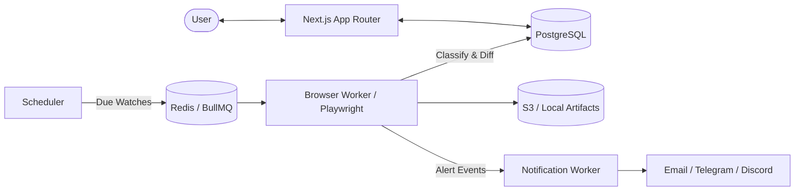

# PagePulse - Website Change Detector

[](https://github.com/JavinKapur/pagepulse-web-change-detector/actions/workflows/ci.yml)
[](LICENSE)
[](https://nodejs.org)

PagePulse monitors publicly accessible web pages and reports meaningful text and visual changes while suppressing noisy differences such as timestamps, counters, rotating promotions, advertisements, and random tokens.

Designed for high reliability, PagePulse renders pages in headless Playwright Chromium, captures visible text and screenshots, computes word-level and pixel-level diffs, and delivers deduplicated alerts via Email, Telegram, and Discord.

---

## 🚀 Key Features

- **Accurate Change Detection:** Separates genuine page updates from dynamic noise, timestamps, and transient counters.
- **Visual & Text Diffs:** Side-by-side snapshot comparison, line/word additions & deletions, and highlighted visual screenshot diffs.
- **Visual Selector Picker:** Configure specific regions to watch or ignore directly via stable CSS selectors.
- **Failure Classification:** Distinguishes genuine changes from network outages (`ERROR`), HTTP 5xx failures, and anti-bot/CAPTCHA challenges (`BLOCKED`), preventing baseline contamination.
- **Shared-Target Deduplication:** Multiple users watching the same URL share a single browser capture job while maintaining independent watch configurations and histories.
- **SSRF & Egress Protection:** Hardened against loopback, private RFC1918, link-local, and cloud-metadata addresses across every navigation and redirect.
- **Multi-Channel Alerts:** Instant notifications via Email (Resend), Telegram Bot, and Discord webhooks with idempotent delivery deduplication and optional daily digests.

---

## 🏗️ Architecture Overview



---

## 📦 Monorepo Structure

```text
pagepulse-web-change-detector/
├── apps/
│   ├── web/                     # Next.js App Router UI, dashboard & REST APIs
│   └── worker/                  # BullMQ scheduler, Playwright capture & alert workers
├── packages/
│   ├── browser/                 # Headless Playwright engine & DOM extraction
│   ├── config/                  # Shared Zod environment schemas & constants
│   ├── core/                    # Normalization, SSRF protection, text & pixel diffing
│   ├── db/                      # Drizzle ORM schema, migrations & AES-256 encryption
│   └── notifications/           # Resend, Telegram, and Discord delivery adapters
├── docs/
│   ├── SDD.md                   # Full Software Design Document
│   ├── ARCHITECTURE.md          # System architecture & sequence diagrams
│   └── OPERATIONS.md            # Deployment, backup, and operations runbook
├── docker-compose.yml           # PostgreSQL, Redis & MinIO services
└── pnpm-workspace.yaml          # Monorepo workspace configuration
```

---

## 🛠️ Quickstart

### Prerequisites

- **Node.js:** `>= 22.0.0` (v24 LTS recommended)
- **pnpm:** `>= 9.0.0`
- **Docker & Docker Compose** (for PostgreSQL, Redis, and MinIO)

### 1. Clone & Install Dependencies

```bash
git clone https://github.com/JavinKapur/pagepulse-web-change-detector.git
cd pagepulse-web-change-detector
pnpm install
```

### 2. Configure Environment

```bash
cp .env.example .env
```

### 3. Start Infrastructure

```bash
docker compose up -d
```

### 4. Run Migrations

```bash
pnpm db:generate
pnpm db:migrate
```

### 5. Start Development Servers

```bash
# Run web dashboard, scheduler, and worker concurrently:
pnpm dev:all
```

Navigate to [http://localhost:3000](http://localhost:3000) to access the PagePulse dashboard.

---

## 🧪 Testing

```bash
# Run all unit and integration tests
pnpm test

# Run tests with coverage
pnpm test:coverage

# Run TypeScript typechecks
pnpm typecheck
```

---

## 🔒 Security & SSRF Protection

All target URLs and navigation redirects are validated against a strict denylist preventing requests to:
- IPv4/IPv6 Loopback (`127.0.0.0/8`, `::1`)
- RFC1918 Private Ranges (`10.0.0.0/8`, `172.16.0.0/12`, `192.168.0.0/16`)
- Cloud Instance Metadata Services (`169.254.169.254`, `[fd00:ec2::254]`)
- Non-standard ports (restricted to `80` and `443` by default)

Sensitive user tokens and webhook configurations are encrypted at rest using AES-256-GCM authenticated encryption.

---

## 📜 License

Licensed under the [MIT License](LICENSE).
Copyright (c) 2026 Javin Kapur.
