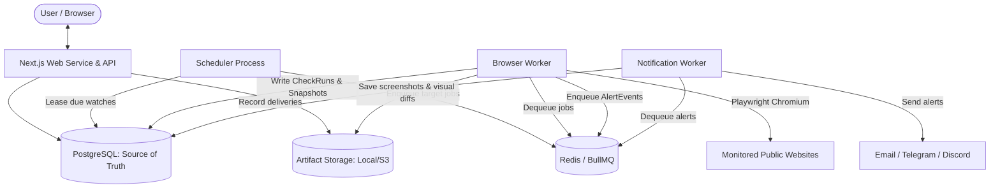

# PagePulse System Architecture

PagePulse is an enterprise-grade website change detection system architected into decoupled, independently scalable components: Web API / Dashboard, Due-Watch Scheduler, Playwright Browser Capture Worker, and Notification Delivery Worker.

## Core Architectural Guarantees

1. **Shared Target Deduplication:**
   When multiple users watch the same URL using the same rendering profile, the scheduler coalesces these into a single capture job. The Playwright worker visits the target once and evaluates all subscriber watches against their independent watch/ignore selectors and noise rules.
2. **SSRF and Egress Protection:**
   URLs undergo strict validation for schemes, ports, loopback addresses (127.0.0.1, ::1), RFC1918 private ranges (10.0.0.0/8, 172.16.0.0/12, 192.168.0.0/16), link-local/carrier-grade NAT (169.254.0.0/16, 100.64.0.0/10), and cloud metadata endpoints (169.254.169.254) prior to fetching and across every HTTP redirect.
3. **Outage vs. CAPTCHA vs. Real Change Classification:**
   Transient timeouts, HTTP 5xx errors, 429 rate limits, and anti-bot challenges (CAPTCHA / Cloudflare Turnstile / 403 Forbidden) are classified as distinct operational statuses (`ERROR`, `BLOCKED`) and strictly prevented from overwriting the established content baseline.
4. **Idempotent Multi-Channel Alerts:**
   Every alert delivery carries an idempotency key `(watchId, snapshotId, channelEndpointId, notificationType)`. Duplicate alerts are suppressed both in the queue and via database constraints.
5. **Zero-Trust Encryption:**
   User webhook URLs, bot tokens, and provider credentials are encrypted at rest using AES-256-GCM authenticated encryption with key versioning.
